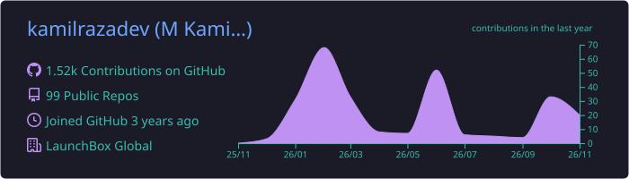
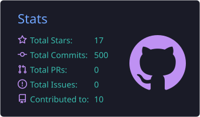
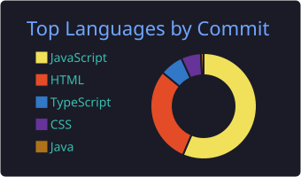
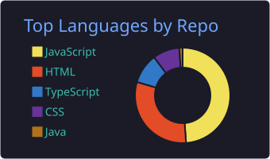
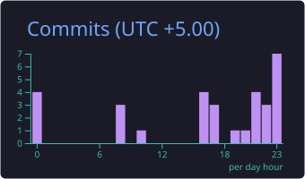

<div align="center">


<a href="https://kamilraza.online">
  
</a>

<p>
  <a href="https://kamilraza.online"></a>
  <a href="https://linkedin.com/in/kamilrazadev"></a>
  <a href="mailto:contact@kamilraza.online"></a>
  <a href="https://kamilraza.online/Muhammad-Kamil-Raza-CV.pdf"></a>
</p>


</div>

---

## 👨‍💻 About Me

I'm a **Full Stack Developer & Team Lead** from Karachi, Pakistan with nearly **4 years** of experience designing, building and deploying scalable web applications with the **MERN stack, Next.js and TypeScript** — across fintech, HR-tech, e-commerce and AI.

```ts
const kamil = {
  role: "Full Stack Developer & Team Lead",
  currentlyAt: "LaunchBox Global",
  location: "Karachi, Pakistan 🇵🇰",
  stack: ["React", "Next.js", "TypeScript", "Node.js", "MongoDB", "AWS"],
  leading: "12 developers · 30+ client apps",
  shipping: "MVPs in 3–6 weeks",
  education: "BS Computer Science — Departmental Topper 🎓",
  openTo: ["Full-time roles", "Freelance", "Contract projects"],
};
```

<div align="center">

| ⏳ Experience | 🚀 Apps Led | 🛠️ Hands-on Builds | 👥 Users Served | 💳 Active Subscriptions |
|:---:|:---:|:---:|:---:|:---:|
| **~4 years** | **30+** | **12** | **200k+** | **3,000+** |

</div>

---

## 🚀 Featured Work

<table>
  <tr>
    <td width="50%" valign="top">
      <h3>🚗 <a href="https://epicridesapp.com">Epic Rides</a></h3>
      <sub><b>Ride-hailing admin & driver platform</b></sub>
      <p>Led web delivery for a platform serving <b>10,000+ drivers & riders</b>, MVP shipped in <b>3 weeks</b>. RBAC admin dashboard, driver onboarding and Stripe subscriptions powering <b>3,000+ active plans</b> and <b>700+ rides/month</b>.</p>
      
      
      
    </td>
    <td width="50%" valign="top">
      <h3>🏠 <a href="https://nexahomeapp.com">NexaHome</a></h3>
      <sub><b>Home services marketplace</b></sub>
      <p>MVP in <b>6 weeks</b> while supervising 2 developers. Four role-based interfaces (homeowners, providers, partners, admins) with lead distribution and partner onboarding. <b>200+ users in month one.</b></p>
      
      
      
    </td>
  </tr>
  <tr>
    <td width="50%" valign="top">
      <h3>🧾 <a href="https://fiveebusiness.com">FiveeBusiness</a></h3>
      <sub><b>US e-tax filing platform</b></sub>
      <p>Delivered <b>solo in 4 weeks</b>. Electronic tax forms with complex automated calculations, e-signatures, Stripe billing and Apple/Google SSO. <b>$35k+ processed</b> in its first filing season.</p>
      
      
      
    </td>
    <td width="50%" valign="top">
      <h3>🤖 <a href="https://recruitaihiring.vercel.app">Recruit AI</a></h3>
      <sub><b>AI-powered recruitment platform</b></sub>
      <p>Dual-LLM system (<b>Gemini + OpenAI</b>) with semantic vector search, AI voice/text interviews with transcription & evaluation, and automated CV screening in seconds.</p>
      
      
      
    </td>
  </tr>
  <tr>
    <td width="50%" valign="top">
      <h3>🔐 <a href="https://squibd.com">Squibd</a></h3>
      <sub><b>Employment history verification</b></sub>
      <p>End-to-end encryption, <b>AES-256 at rest</b>, 2FA and RBAC across three interfaces. Batch processing, message queues and load balancing for bulk uploads at peak load.</p>
      
      
      
    </td>
    <td width="50%" valign="top">
      <h3>🩺 PreMed.Pk</h3>
      <sub><b>Medical exam-prep platform</b></sub>
      <p>Platform serving <b>200,000+ medical students</b>. Built the MCQ engine (<b>170k+ questions</b>, timed attempts, analytics), subscriptions, admin dashboard and an SEO blog. Contributed to <b>50%+ user growth</b>.</p>
      
      
      
    </td>
  </tr>
</table>

<p align="center"><a href="https://kamilraza.online/#work"><b>→ See all my work on kamilraza.online</b></a></p>

---

## 🛠️ Tech Stack

<div align="center">

**Languages & Frontend**


**Backend & Databases**


**Cloud, DevOps & Tools**


**Integrations**


</div>

---

## 💼 Experience

| Role | Company | Period |
|---|---|---|
| **Full Stack Developer (MERN) — Team Lead** | LaunchBox Global | Feb 2025 – Present |
| **Full Stack Developer (MERN)** | AMG Digital Solutions | Nov 2023 – Jan 2025 |
| **MERN Stack Developer** | PreMed.Pk | Mar 2023 – Oct 2023 |
| **MERN Stack Intern** | Info Aid Tech | Jan 2023 – Feb 2023 |

**Highlights**
- ⚡ Raised a client site's Lighthouse performance score from the **40s to the 90s** through query optimisation, caching and code splitting
- ☁️ Provision and deploy production servers on **AWS EC2 & Elastic Beanstalk** with **GitHub Actions CI/CD**
- 🧠 Built a blog portal that uses **AI to generate SEO metadata and JSON-LD** at publish time
- 🧭 Set coding standards, Git workflows and structured code review across a 12-developer team

---

## 🏆 Achievements

- 🥇 **Winner — CodeJam 2.0**, Google Developer Student Clubs (2024) · first among 50+ participants city-wide
- 🥇 **Winner — SDS 1.0 Web Development Competition**, SWIT (2023) · first among 400+ participants
- 🎓 **Departmental Topper**, BS Computer Science (Spring 2022 batch), SMIU · awarded a laptop by the university

---

## 📊 GitHub Stats

<div align="center">










</div>

---

## 🤝 Let's Build Something Great

I'm open to **full-time roles** as well as **freelance and contract projects**. Recent MVPs shipped in 3–6 weeks — tell me what you're building.

<div align="center">

<a href="https://kamilraza.online/contact"></a>
<a href="https://twitter.com/kamilraza_dev"></a>
<a href="https://www.hackerrank.com/kamilrazadev"></a>


</div>
